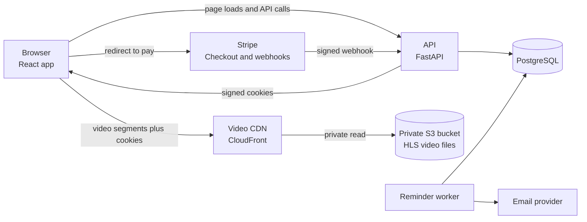
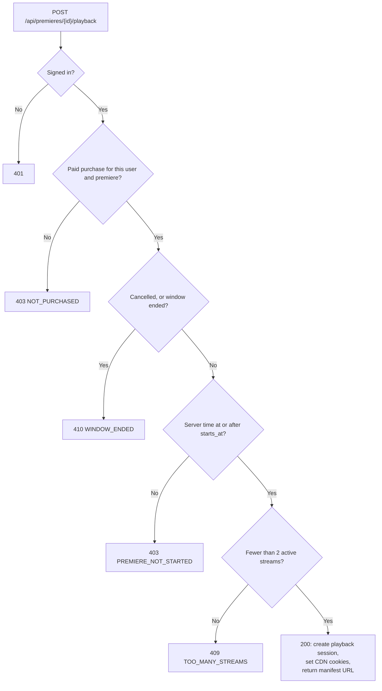

# System design

**Status:** design complete. Only the database layer is built (see [data-model.md](data-model.md)). The API, payments, video delivery, and frontend described here are planned.

## Summary

V1 is **embargoed video on demand**. The video unlocks for paying viewers at the premiere time, a CDN serves it, and the API only decides who may watch and when. The API never carries video.

## Scope clarifications

The scope document left six questions open. Each one is settled here with a default, so the design can move forward.

| Question | Decision | Why it matters |
| --- | --- | --- |
| What does "synchronized premiere" mean? | Embargoed on demand: the video unlocks at the premiere time and each viewer presses play whenever they like afterward. Everyone-at-the-same-second playback waits for watch parties (Phase 3). | Synchronized playback needs live-style streaming and per-viewer position sync, which multiplies the work. The unlock moment is what V1 must get exactly right. |
| Sales and access window | Sales stay open until the window closes. Access runs from the premiere time to a window end the admin sets (default 7 days). One purchase per user per premiere. | Drives the purchase rules, the playback check, and the refund cases. |
| Simultaneous streams | At most 2 active streams per purchase. | Without a limit, one purchase can feed unlimited viewers. |
| Refunds and cancellation | A cancelled premiere refunds every paid purchase automatically. Viewer-requested refunds go through an admin in V1. | The payment webhook needs a refund path from day one. |
| Numbers for non-functional requirements | Load-tested at 1,000 concurrent viewers, designed so the CDN can carry 10,000. Non-video API requests under 300 ms at the 95th percentile. Video starts within 5 seconds of pressing play. No single server in the path. | "Eventually a million users" cannot be tested. These can. |
| Test content | A Creative Commons film, such as one of the Blender Foundation's open movies. Check each film's license and credit it. | Real video is needed to test playback, without rights problems. |

The scope's first architecture sketch chained Users, Movies, Purchases, PostgreSQL, Stripe, Video Service, and CDN into one line. In reality payment and video are two separate paths that meet at one decision: the access check. The diagrams below split them.

## Architecture at a glance

The browser loads the site and the video from two separate CDN paths and asks only the API for decisions. The API signs cookies with a private key. The video CDN verifies them with the matching public key, and that key pair is the only link between the two. A reminder worker reads the same database and sends email.



## The premiere gate

`POST /api/premieres/{id}/playback` is the whole product. It is the only place that decides who may watch and when. Each failure has its own error code, so the React app can show the right message. The CDN stays a second lock if anyone skips the API. Every time comparison uses server time. A cancelled premiere takes the same exit as an ended window.



**Acceptance criterion, as a testable sentence:** given a paid purchase and a server time before the premiere, requesting playback returns `403 PREMIERE_NOT_STARTED` and sets no cookies.

Example success response (illustrative):

```json
{
  "manifestUrl": "https://cdn.example.com/premieres/42/master.m3u8",
  "expiresAt": "2026-10-30T00:30:00Z",
  "sessionId": "c0a8b1f2-0000-0000-0000-000000000000",
  "resumeAtSeconds": 0
}
```

Example failure response (illustrative). The `details` object lets the client correct its clock offset:

```json
{
  "error": {
    "code": "PREMIERE_NOT_STARTED",
    "message": "This premiere has not started yet.",
    "fields": {},
    "details": {
      "startsAt": "2026-10-30T00:00:00Z",
      "serverNow": "2026-10-29T23:59:58Z"
    }
  }
}
```

## API

Most of the API is ordinary REST. The gate is the exception.

| Method and path | Who | What it does | Errors |
| --- | --- | --- | --- |
| `GET /api/movies` | Anyone | Published movies with their next premiere, paginated | 422 |
| `GET /api/movies/{slug}` | Anyone | One movie with its premieres | 404 |
| `GET /api/time` | Anyone | Server time in UTC, used to sync the countdown | none |
| `/api/auth/*` (signup, login, logout, me, forgot-password, reset-password) | Mixed | Account endpoints | 401, 409, 423, 429 |
| `POST /api/premieres/{id}/checkout` | Signed in | Creates a pending purchase and a Stripe Checkout Session, returns `checkoutUrl` | 404, 409 ALREADY_PURCHASED, 410 SALES_CLOSED |
| `POST /api/webhooks/stripe` | Stripe only | Verifies the signature, then marks purchases paid, expired, refunded, or disputed and sends the confirmation email | 400 bad signature |
| `GET /api/me/purchases` | Signed in | The library: purchases with movie, premiere, and computed state | 401 |
| `POST /api/premieres/{id}/playback` | Signed in | **The gate.** Returns `manifestUrl`, `expiresAt`, and `sessionId`, and sets the CDN cookies | 401, 403 NOT_PURCHASED, 403 PREMIERE_NOT_STARTED, 410 WINDOW_ENDED, 409 TOO_MANY_STREAMS |
| `POST /api/playback/{sessionId}/heartbeat` | Session owner | Keeps the session active, saves the position, renews the CDN cookies before they expire | 403 ACCESS_REVOKED, 404 |
| `DELETE /api/playback/{sessionId}` | Session owner | Ends the session | 404 |
| `PUT` and `DELETE /api/premieres/{id}/reminder` | Signed in | Sets or removes a reminder email | 404, 410 |
| `POST /api/admin/movies`, `PATCH /api/admin/movies/{id}` | Admin | Create or edit catalog entries | 403, 422 |
| `POST /api/admin/premieres`, `PATCH /api/admin/premieres/{id}` | Admin | Schedule or change a premiere. Needs a ready video asset and a future start | 403, 409, 422 |
| `POST /api/admin/premieres/{id}/cancel` | Admin | Sets `cancelled_at` and queues refunds | 403, 404 |
| `GET /api/admin/dashboard` | Admin | Sales, revenue, active viewers, upcoming premieres | 403 |

**Conventions**

- One error shape: `{"error": {"code", "message", "fields"}}`, plus an optional `details` object for the gate's errors.
- camelCase JSON, UTC timestamps in ISO format, money in integer cents.
- Ownership in every query. A user can only see their own purchases and sessions, and a wrong id returns 404, not 403, so ids cannot be probed.
- Rate limits on login, checkout, and the gate (for example 10 gate requests per minute per user) so nobody can farm tokens.
- After sales begin, the price is locked and the start time can only move later, and buyers are emailed. Without this rule an admin edit could break what customers already paid for.

## Frontend

The hard part of the frontend is the countdown and the instant it reaches zero. Everything else is standard React.

| Screen | Route | Notes |
| --- | --- | --- |
| Catalog | `/` | Upcoming and live premieres as a poster grid, with price and the premiere time in the viewer's own time zone |
| Movie detail | `/movies/:slug` | Trailer, synopsis, runtime, rating, and the premiere card |
| Account | `/login`, `/signup`, `/forgot-password`, `/reset-password` | Standard account screens |
| Checkout return | `/checkout/success`, `/checkout/cancelled` | The success page polls `/api/me/purchases` until the purchase is paid, because the webhook can land a few seconds after the redirect |
| Library | `/library` | Purchases, each with a countdown or a Watch button |
| Watch | `/watch/:premiereId` | The player |
| Admin | `/admin`, `/admin/movies`, `/admin/premieres` | Dashboard, catalog, and scheduling form. Hidden from non-admins in the UI and enforced in the API |

### The premiere card has eight states

The card reads the premiere's computed state and the viewer's purchase status from the API, so the rules live in one place and the client never re-derives them.

| State | Condition | Card shows | Action |
| --- | --- | --- | --- |
| 1. Visitor | Signed out, on sale | Poster, time, price | "Reserve premiere", then log in, then checkout |
| 2. Not purchased, early | Signed in, no purchase, before start | Time and price | "Reserve premiere" |
| 3. Not purchased, live | Signed in, no purchase, premiere live | "Premiere is live now" | "Buy and watch now" |
| 4. Payment pending | Pending purchase, Checkout session still open | "Finish your payment" | Resume checkout |
| 5. Purchased, waiting | Paid, before start | Countdown "PREMIERE BEGINS IN" and a reminder toggle | None until zero |
| 6. Purchased, live | Paid, live | "Watch now" | Opens `/watch` |
| 7. Window ended | Paid, after `window_ends_at` | "Access has ended" | None |
| 8. Cancelled | `cancelled_at` set | "Cancelled. Purchases refunded" | None |

### How the countdown works

- **Sync once, then count locally.** Read `serverNow` from `/api/time`, store the offset from the device clock (corrected by half the round trip), and tick with `performance.now()`, so changing the device clock mid-countdown does nothing.
- **Re-sync every 5 minutes and when the tab regains focus.** Browsers slow timers in background tabs.
- **At zero, ask the server, not the clock.** Call the gate. If it answers `PREMIERE_NOT_STARTED`, read `details.startsAt` and `details.serverNow`, correct the offset, and retry after a random 0 to 1.5 seconds. The random delay spreads thousands of viewers across a second or two instead of one instant.
- **Never show "Watch now" from the device clock alone.**
- **Accessibility.** Announce the countdown to screen readers once a minute (`aria-live="polite"`), not every second, and show the exact premiere time as plain text.

### How the player works

- hls.js plays the stream in Chrome, Firefox, and Edge. Safari plays HLS natively. Controls: play, pause, volume, fullscreen, seeking, quality (automatic by default, manual levels from hls.js), and subtitles as WebVTT tracks when a movie has them.
- A heartbeat every 60 seconds sends the current position. The response renews the CDN cookies and can say `ACCESS_REVOKED`, in which case the player stops with a clear message.
- Playback resumes from `resumeAtSeconds`, returned by the gate.
- Every failure gets a plain message: `NOT_PURCHASED`, `TOO_MANY_STREAMS` ("Stop watching on another device"), a dropped network (hls.js retries, then shows "Reconnecting"), and expired cookies after a laptop sleeps (call the heartbeat to renew, then retry).
